<!-- markdownlint-disable MD033 MD041 -->
<div align="center">

# 🔌 apcupspi

<!-- markdownlint-disable-next-line MD001 -->
### Turn a Raspberry Pi into an APC Network Management Card

*Give any NUT-monitored UPS a real **AP9631 (NMC2)** web UI, SNMP agent and
management card presence — for the price of a Pi.*

[](https://www.raspberrypi.com/)
[](https://www.raspberrypi.com/software/)
[](https://www.python.org/)
[](https://networkupstools.org/)
[](https://github.com/ArMaTeC/apcupspi/commits)
[](https://github.com/ArMaTeC/apcupspi)

</div>

---

**Contents** · [What is this?](#-what-is-this) · [Features](#-features) ·
[Screenshots](#-screenshots) · [Install](#-install) ·
[Wizard](#-configuration-wizard) · [Alerts](#-alerts) ·
[API](#-api--integration) · [Security](#-security) · [FAQ](#-faq)

## ⚡ What is this?

`apcupspi` transforms a fresh Raspberry Pi OS install into a complete
**emulated APC Network Management Card** — the kind of management interface
you'd normally need an expensive AP9631 card for:

- Your UPS is monitored locally by **NUT** (USB/serial)
- The Pi serves an **HTTPS web UI** that looks and behaves like a real NMC2
- **SNMP** answers PowerNet-MIB queries exactly like APC hardware, so your
  NMS (Zabbix, LibreNMS, PRTG, UPS-aware shutdown tools, hypervisors…)
  can't tell the difference
- It's reachable as **`hostname.local`** out of the box (mDNS via Avahi)

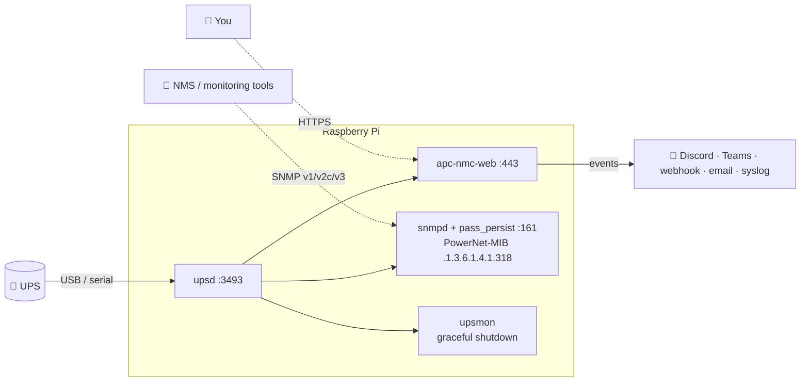

## ✨ Features

| | |
| --- | --- |
| 🌐 **NMC2 Web UI** | Port `443` (`:80` redirects) — status, logs, control, tests and configuration, backed live by NUT |
| 📡 **SNMP Agent** | Port `161` — APC PowerNet-MIB (`.1.3.6.1.4.1.318`) via `pass_persist`; v1/v2c communities + v3 read-only user; GET/GETNEXT/SET + traps |
| 🔋 **NUT Backend** | `upsd` on `3493` + `upsmon` shutdown controller; `apc_modbus` **built from vendored NUT 2.8.5 source** on the target (prebuilt binary as fallback); auto-detects the UPS USB VID/PID at driver start |
| 🛡️ **Resilience** | Kernel watchdog + `RuntimeWatchdogSec`, panic-reboot sysctl, per-service OOM tuning, `net-watchdog` connectivity recovery (per-interface gateway checks, Wi-Fi firmware wedge recovery) |
| 🔔 **Alerts** | UPS events pushed to Discord, Teams, HTTP webhook, email (SMTP) or syslog — per-event routing matrix + severity filter + test buttons |
| 🧙 **Setup Wizard** | Interactive first-boot wizard (hostname, credentials, network, UPS, SNMP, alerts, certs) — re-runnable anytime |
| 📈 **Metrics** | Prometheus `/metrics` endpoint + JSON API + raw `events.txt`/`data.txt` like a real card |

## 📸 Screenshots

<div align="center">

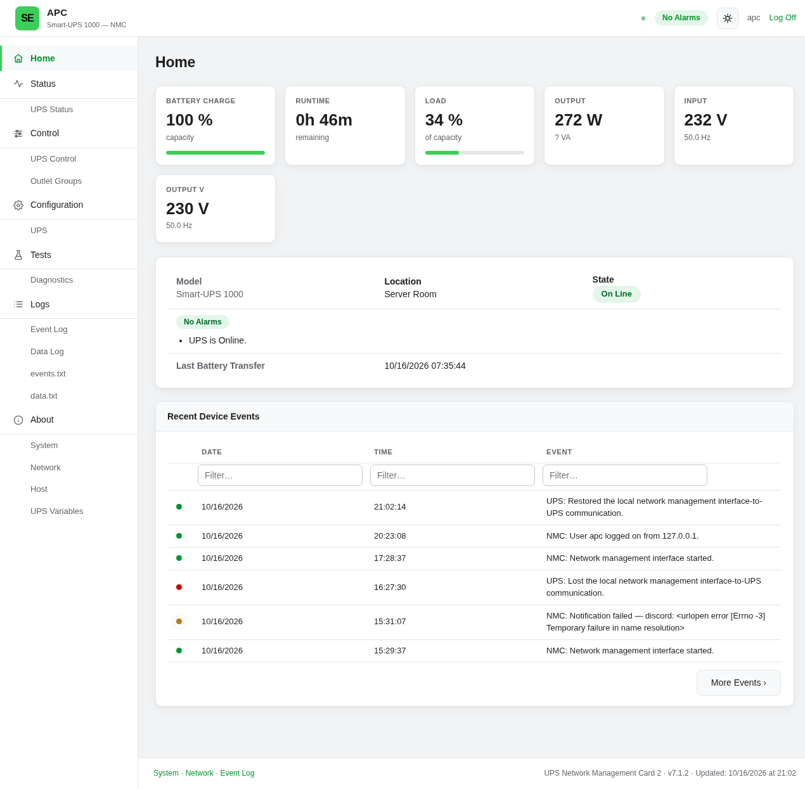

*Home — live charge, runtime, load, input/output and the rolling event log*

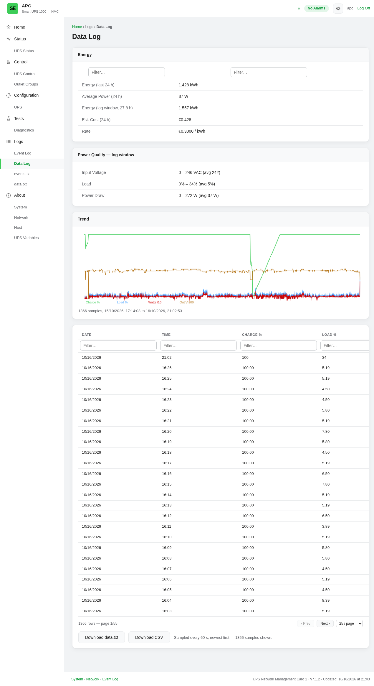

*Data Log — energy usage, power-quality trend and per-minute samples*

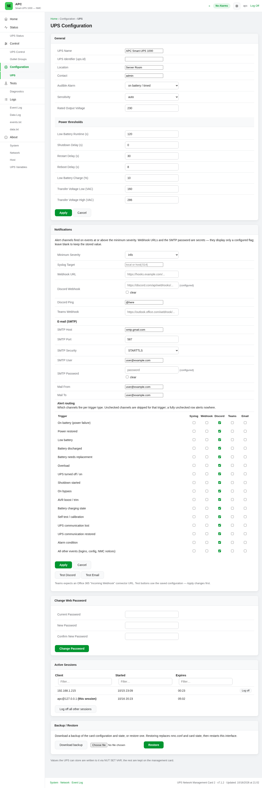

*Configuration — thresholds, the full alert-channel setup with per-trigger
routing, sessions and backup/restore*

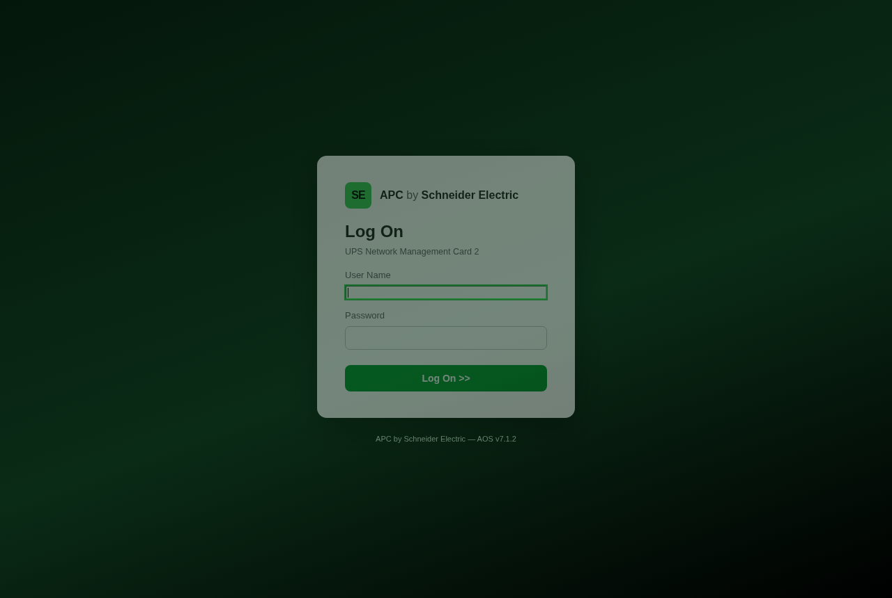

</div>

<details>
<summary><b>Every page</b> — click to expand the full tour</summary>

<div align="center">

| | |
| --- | --- |
| 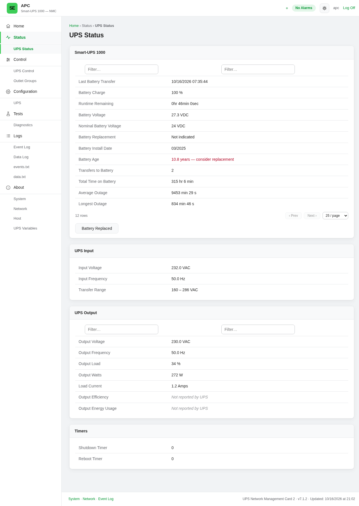 | 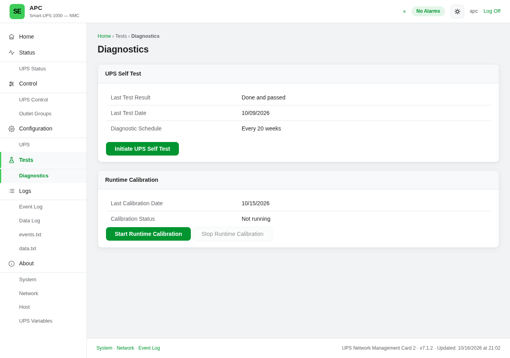 |
| *Status — battery, input, output, timers* | *Tests — self-test & runtime calibration* |
| 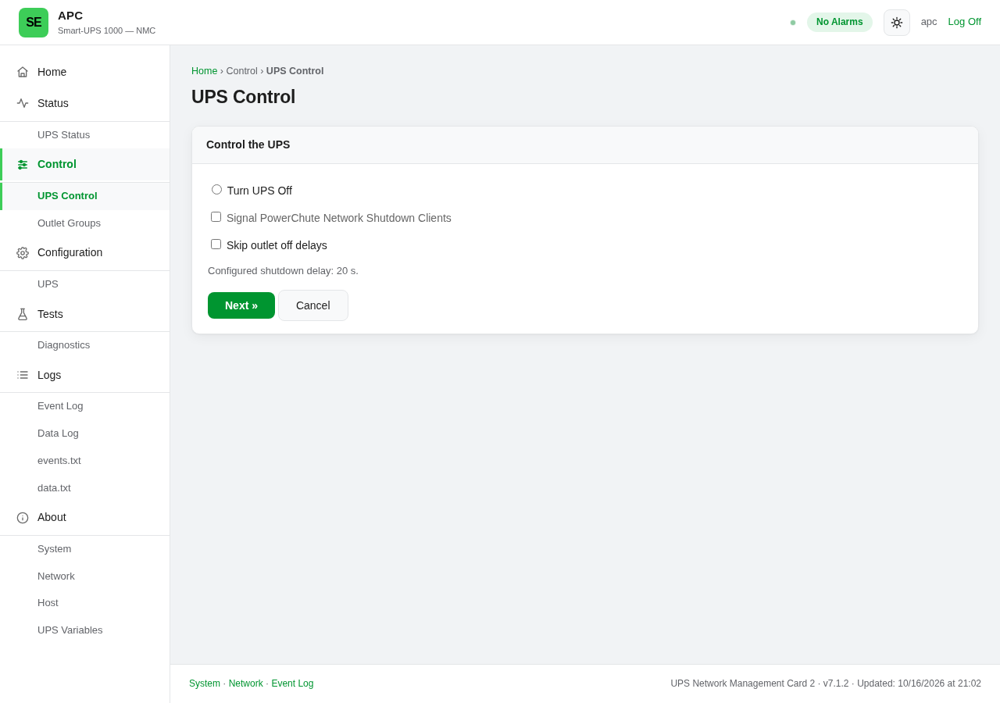 | 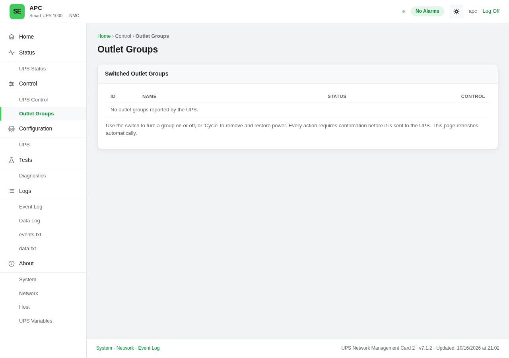 |
| *Control — safe shutdown / PCNS signaling* | *Outlet groups — per-group power control* |
| 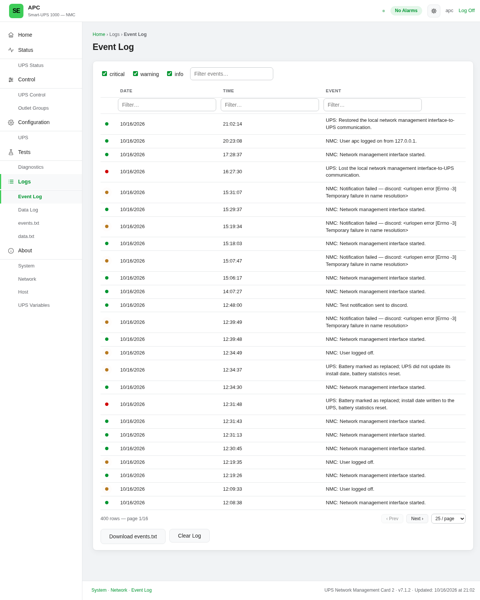 | 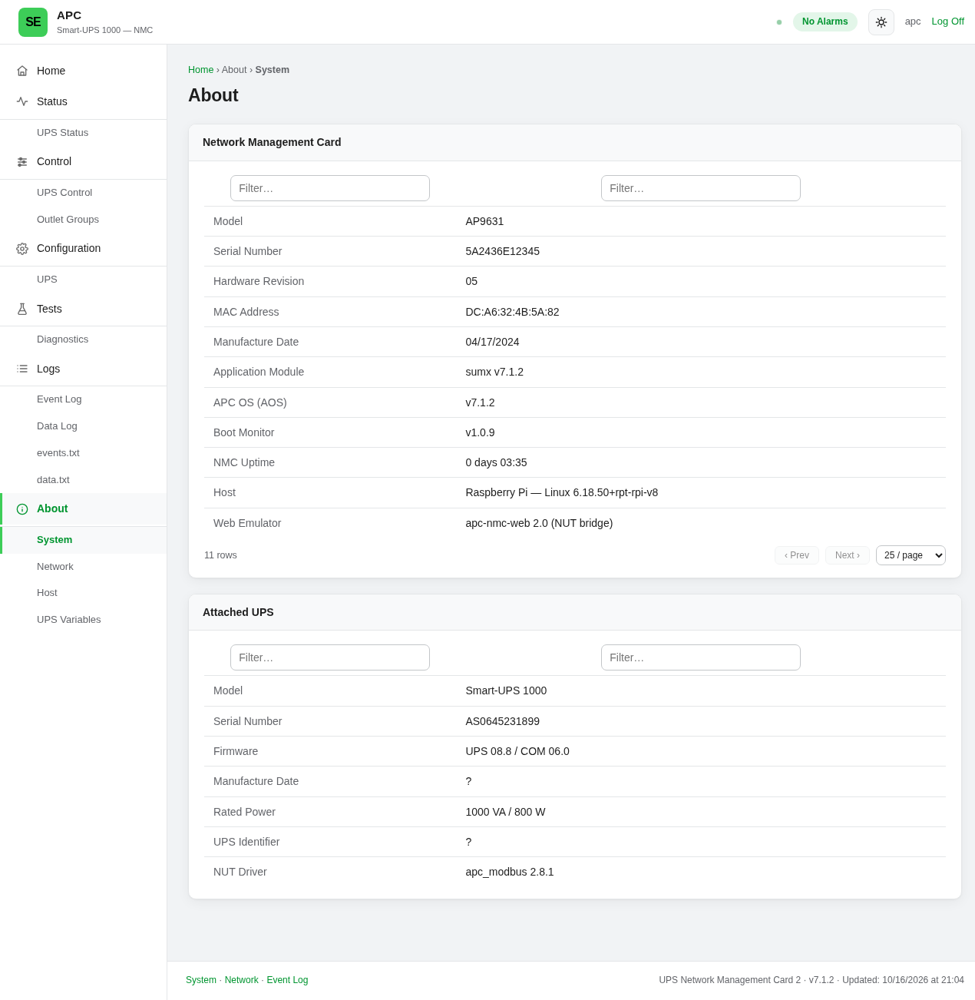 |
| *Event log — severity-filtered history* | *About — NMC identity & attached UPS* |
| 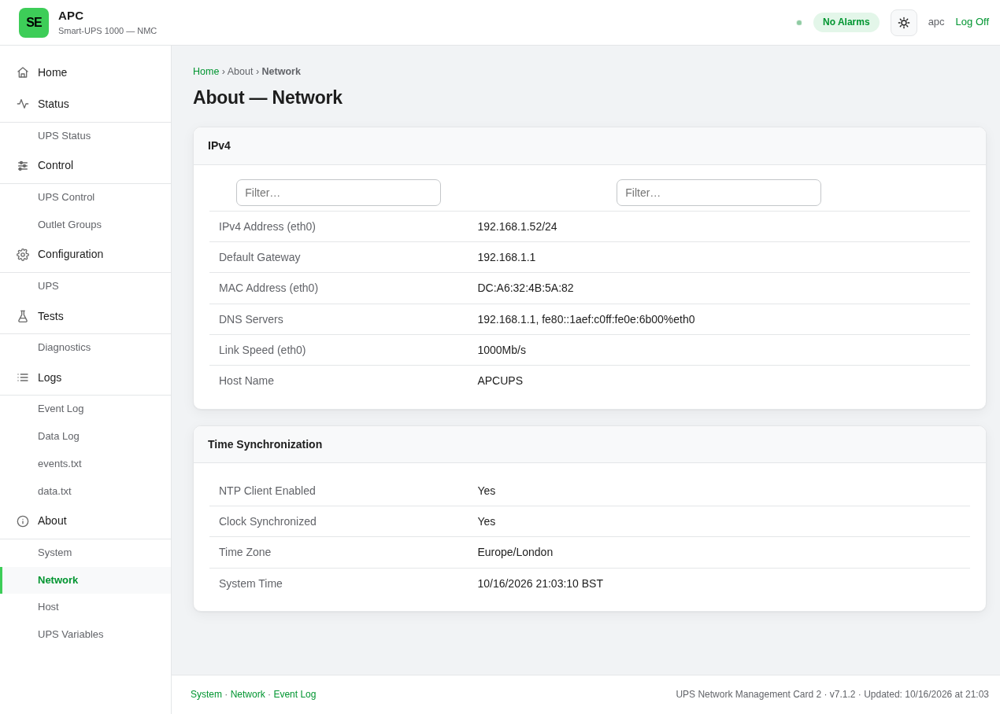 | 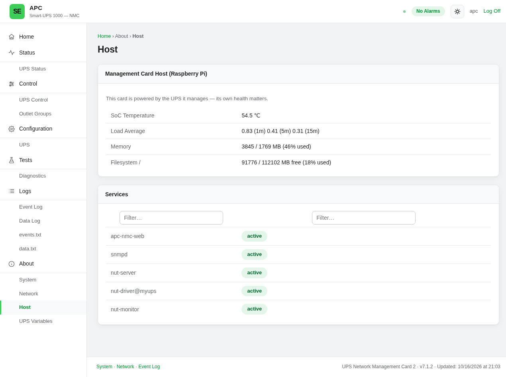 |
| *Network — addressing, DNS, NTP* | *Host — Pi SoC temp, memory, services* |
| 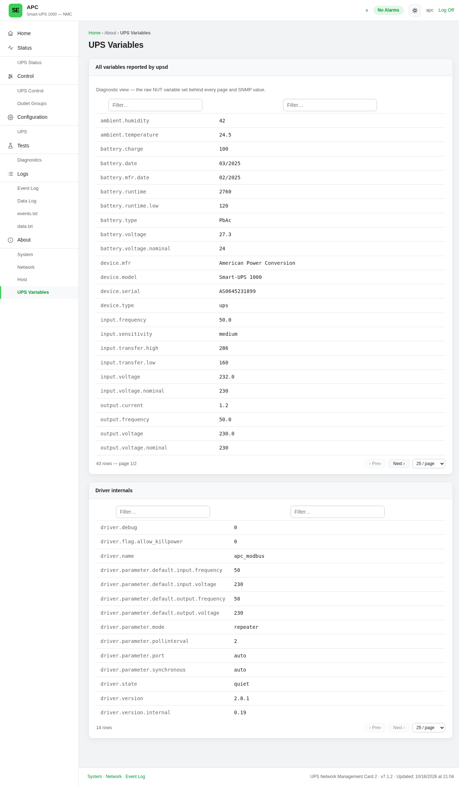 | |
| *Raw NUT variables behind every page* | |

</div>
</details>

## 🚀 Install

**Requirements:** Raspberry Pi 4 or 5 · Raspberry Pi OS (or Debian) 64-bit ·
~2 GB free disk (vendored NUT/libmodbus are compiled on the target) · a UPS
supported by NUT.

Flash **Raspberry Pi OS (64-bit)** — Imager customisation (hostname, user,
SSH key, WiFi) is honoured — then either:

**Clone & run:**

```bash
git clone https://github.com/ArMaTeC/apcupspi.git
cd apcupspi
sudo ./install.sh
```

**One-liner** (always fetches the latest commit — raw.githubusercontent can
serve a cached copy for a few minutes after pushes):

```bash
curl -fsSL https://github.com/ArMaTeC/apcupspi/archive/refs/heads/main.tar.gz | tar -xz -C /tmp && sudo bash /tmp/apcupspi-main/install.sh
```

## 🧙 Configuration wizard

Runs at the end of the install, and can be re-run any time via
`sudo firstboot-wizard.sh`. It collects:

- 🏷️ Hostname + new root password
- 🔑 SSH public key for root (optional)
- 🌍 Network — DHCP or static IP/gateway/DNS
- 🔐 Web-interface admin credentials
- 🔋 UPS name, NUT driver & port, NUT monitor/admin passwords
- 📡 SNMP communities, device location & contact
- 🔔 Alert channels — Discord / Teams / generic webhook, email (SMTP), syslog + minimum severity (optional, with live test sends)
- 🔒 Fresh self-signed HTTPS certificate (auto-generated)

## 🔌 Ports & services

| Port | Service | Purpose |
| ------ | --------- | --------- |
| `443/tcp` | `apc-nmc-web` | HTTPS management UI (`80` redirects) |
| `3493/tcp` | `nut-server` (`upsd`) | NUT network daemon — monitor remotely |
| `161/udp` | `snmpd` | SNMP — PowerNet-MIB subtree |
| `22/tcp` | `sshd` | Admin access |

## 🛠️ Install-time options

| Prompt | What it does |
| -------- | -------------- |
| Hardware hardening | `enable_uart`, hardware watchdog, disable onboard WiFi/BT |
| Pi 4 overclock | `arm_freq=1750`, `over_voltage=2`, `gpu_freq=600` (Pi 5 ignores it) |
| `/var/swap` | Creates a dedicated 10G swapfile |
| Argon One | Fan/button daemon + i2c, if you run the Argon One case |

## 🔔 Alerts

UPS events — power loss/restore, low battery, overload, comms loss,
self-test results, alarms — can be pushed to **Discord**, **Teams**, any
**HTTP webhook**, **email (SMTP)** or **syslog**.

Configure channels in the wizard or later in the web UI (*Configuration →
UPS → Notifications*): per-channel test buttons, a minimum-severity filter
and a per-trigger routing matrix (e.g. Discord for power events, email for
everything). Criticals can ping a Discord mention. At boot the service
waits for DNS before dispatching, so early alerts aren't dropped.

## 🧩 API & integration

JSON endpoints on the management UI (behind the web login unless noted):

- `GET /api/v1/vars` — live UPS variables (status, load, battery…)
- `GET /api/v1/commands` — instant commands the UPS exposes
- `GET /datalog.json` — logged power-quality samples
- `GET /events.txt`, `GET /data.txt` — raw event/data logs, same as a real NMC
- `GET /metrics` — Prometheus exposition (localhost or logged-in)
- `GET /healthz` — liveness probe for uptime checks (unauthenticated)
- `GET /ca.crt` — download the generated CA to trust the self-signed cert
- `GET /config/backup` — download `apc-nmc-config.tgz` (config + state + events)
- `POST /config/restore` — restore a saved config bundle

## 🔐 Security

- Web password is stored as **PBKDF2-SHA256** (200k iterations); login is
  rate-limited with lockout, sessions are `HttpOnly`+`Secure`+`SameSite=Lax`
  cookies with CSRF tokens on every POST
- All config/secrets (`upsd.users`, `nmc.conf`, state) are generated at
  install/wizard time — nothing secret ships in this repo
- `upsd` listens on all interfaces for remote monitoring — keep the box on a
  trusted/management network or firewall `3493` to your monitoring hosts
- The web UI is self-signed; grab `/ca.crt` to pin trust instead of
  clicking through warnings

## 📁 Repo layout

The repo mirrors filesystem layout — files land exactly where they sit:

```text
install.sh                  installer (payload = this repo)
├── docs/img/               README screenshots
├── usr/local/bin/          apc-nmc-web.py · apc-nmc-agent.py · web UI assets
├── usr/local/sbin/         firstboot-wizard.sh · net-watchdog.sh · nut-usb-detect.sh
├── usr/lib/nut/apc_modbus  fallback prebuilt NUT driver (arm64)
├── usr/local/lib/          fallback libmodbus.so.5 (runtime dep of apc_modbus)
├── vendor/                 NUT 2.8.5 + NUT libmodbus fork sources (built on target)
├── etc/nut/                NUT config templates (secrets generated, never shipped)
├── etc/apc-nmc/            nmc.conf.default + public CA material
├── etc/systemd/system/     units, timers, hardening & OOM drop-ins
├── etc/logrotate.d/        agent/state log rotation
├── etc/sysctl.d/           panic-reboot + OOM tuning
└── etc/argon/              optional Argon One fan daemon
```

## ❓ FAQ

**Which UPSes work?**
Anything NUT supports — `apc_modbus` is the default (APC MODBUS-over-USB),
but `usbhid-ups`, `apcsmart`, `blazer_usb` and friends all work. The wizard
asks which driver/port to use, and `nut-usb-detect` fills in the VID/PID
automatically at driver start.

**Pi 4 or Pi 5?**
Both. `config.txt` uses per-model sections; only the Pi 4 gets the optional
overclock.

**What are the default web credentials?**
The wizard sets them during install — there is no shipped password. If you
skip the wizard the UI falls back to `apc`/`apc`; change it on the
Configuration page (*Change Web Password*).

**Does it work headless?**
Yes — it's designed as a network appliance. Console is only needed if you
disable WiFi *and* can't reach it via Ethernet.

**Where's my data?**
Runtime state and secrets live outside the repo: `/etc/apc-nmc/nmc.conf`,
`/var/lib/apc-nmc/{state,events,datalog,sessions}.json`, agent log in the
same dir (logrotated). Config backup/restore is built into the UI.

---

<div align="center">

*Not affiliated with or endorsed by APC / Schneider Electric. "APC" and
"PowerNet" are trademarks of their respective owners — used here to
describe emulation compatibility.*

</div>
